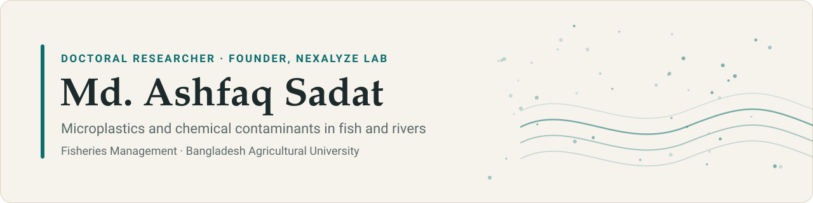

<picture>
  <source media="(prefers-color-scheme: dark)" srcset="assets/banner-dark.svg">
  
</picture>

  
  
  
  
  
  

I'm a PhD researcher in the Department of Fisheries Management at Bangladesh Agricultural University. My work asks what microplastics and everyday chemicals, such as triclosan and ivermectin, do to fish, and what that means for the rivers of Bangladesh and the people who eat from them. Most of my lab work uses Nile tilapia; the field side follows the Old Brahmaputra down to the Meghna estuary.

I also run [Nexalyze Lab](https://www.nexalyzelab.com), where I teach GIS, statistics and research tools and help students with their data analysis. This GitHub is where the code from both ends up.

### Research

- **Microplastics** in water, sediment and fish, and how temperature and other pollutants change the harm
- **Pharmaceuticals and personal care products** and their toxicity to early life stages of farmed fish
- **Risk assessment and One Health**, from contaminant measurements to exposure estimates for people
- **Fisheries and wetland ecology** in the haor floodplains and the Sundarbans

### Selected publications

- Kanok NJR, Sharmin S, **Sadat MA**, et al. (2026). Combined toxicity of polyethylene microplastics and chromium on the developmental stage of Nile tilapia. *Toxicology and Environmental Health Sciences*. [doi:10.1007/s13530-026-00341-8](https://doi.org/10.1007/s13530-026-00341-8)
- Al-Emran M, Sarker A, Adib SS, Nayem MJ, Sultana T, **Sadat MA**, Shahjahan M (2025). Microplastics pollution in aquatic ecosystems of Bangladesh: a critical review. *Science of the Total Environment* 1002, 180620. [doi:10.1016/j.scitotenv.2025.180620](https://doi.org/10.1016/j.scitotenv.2025.180620)
- Sumon KA, Kanok NJR, **Sadat MA**, et al. (2025). A comprehensive review on the negative impacts on Sundarbans fisheries. *Marine Pollution Bulletin* 220, 118409. [doi:10.1016/j.marpolbul.2025.118409](https://doi.org/10.1016/j.marpolbul.2025.118409)
- Hasan J, Siddik MA, Ghosh AK, Mesbah SB, **Sadat MA**, Shahjahan M (2023). Increase in temperature increases ingestion and toxicity of polyamide microplastics in Nile tilapia. *Chemosphere* 327, 138502. [doi:10.1016/j.chemosphere.2023.138502](https://doi.org/10.1016/j.chemosphere.2023.138502)

Full list on [my website](https://ashfaq-sadat.github.io/#publications) and [Google Scholar](https://scholar.google.com/citations?user=pQL-hZsAAAAJ&hl=en).

### Tools I work with

  
  
  
  
  
  
  
  

### On this profile

| Repository | What it is |
| --- | --- |
| [ashfaq-sadat.github.io](https://github.com/ashfaq-sadat/ashfaq-sadat.github.io) | My academic website, with a weekly Google Scholar update |
| [Larvae_HeartRate_detection](https://github.com/ashfaq-sadat/Larvae_HeartRate_detection) | Heart-rate measurement for fish larvae in toxicity tests |
| [styles](https://github.com/ashfaq-sadat/styles) | A Zotero citation style for BAU's dissertation format |

### Get in touch

Email [sadat43747@bau.edu.bd](mailto:sadat43747@bau.edu.bd), or find me on [LinkedIn](https://www.linkedin.com/in/ashfaqsadat) and [Facebook](https://www.facebook.com/ashfaqsadat). For courses and analysis help, the [Nexalyze Lab page](https://www.facebook.com/nexalyzelab) is the quickest way.
